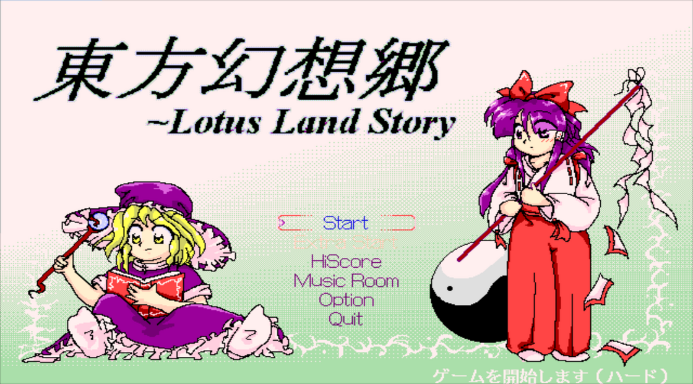
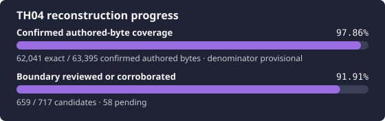

# 東方幻想郷 ～ Lotus Land Story

<p align="center">
  
</p>

<p align="center">
  
</p>

This repository reconstructs the original Japanese PC-98 **Touhou 4:
Lotus Land Story**. The active goal is to build `MAIN.EXE`, `OP.EXE`,
`MAINE.EXE` and `ZUN.COM` from maintained TH04 source and run the full game.
Native builds need not reproduce the original executable bytes. MAIN's two
remaining historical exactness cases are deferred.

[New-agent handoff](docs/NEXT_AGENT_HANDOFF.md) records both branch baselines,
comparison limits, next tasks and the current missing-worktree recovery issue.
[Current state and remaining work](docs/RE_HANDOFF.md) indexes retained evidence.
Historical function acceptance is reported by `python3 scripts/status.py` and
[PROGRESS.md](docs/PROGRESS.md); it is separate from gameplay completion.

## Current products and navigation

The primary original/reconstructed DOS comparison completes 10394 Stage2
updates, Kurumi defeat/clear, Stage3 initialization and its first update. Nine
full pools, 22 states, 11636 ordered RNG calls and 38 configured video regions
agree over 31196 boundaries. The DOS aggregate retains
544 post-reset key/31196 raw-GDC differences and
12 additional UI raw-GDC differences. Older vectors remain separate.

Current 566/4c3c50cb cold GNU and optimized UBSan match 20795 selected scalar
records and 10397 full nine-pool snapshots, actual consumed inputs, homing and
Boss/Midboss/RNG. Physical CFG/SCR files and the legacy 3500/8000 plus 59 RGB/TRAM
fixtures pass. Native Stage2 pictures, natural clocks, complete campaigns, NP2,
Windows, pristine provenance and historical exactness remain open. Both full
goals stay active; see the [current handoff](docs/RE_HANDOFF.md).

Development is active. All four DOS products build from maintained local source.
Retained original/reconstructed DOS comparisons agree across all four bundled
demos on consumed input, score and RNG, nine complete actor/effect pools, and 22
Boss/Midboss/player state blocks. These demos exercise Midboss fights; ordinary
Boss combat has a separate bounded comparison below. Complete process
transitions remain open. Complete
Demo video captures cover both graphics pages, all four
planes, text, palettes and selected GDC display fields. Text, palettes and the
compared display fields agree. Cold builds and complete replays verify repairs
to the Stage 4 carpet columns, packed bullet invalidation dimensions and
point-number multiplier glyphs. Restoring a missing Stage 4 lighting-animation
cell now also resolves Demo 1's remaining graphics differences. All four demos
agree on every compared video region across all 3,996 updates each. Full
scanout timing remains open; see the handoff for the current evidence.

Two repeated ordinary Stage 1 pairs agree through 3,996 updates on consumed
input, 36 state fields and 1,369 ordered RNG calls, including two natural deaths
and respawns. Keyboard device events begin at the original OP's observed menu
counter; no RNG or gameplay state is assigned. New after-update captures also
agree on nine whole object/effect pools and 22 state blocks; three pools stay
empty. The latest companion aggregate retains 155 differing end-of-update
keyboard samples despite equal consumed inputs and independent scalar/RNG
controls. Complete video captures now agree on both pages of all four VRAM
planes, the text plane, palettes and configured GDC display fields across this
ordinary fragment. Raw GDC timing differs on every frame and is retained.
A longer 7,500-update fragment now also pairs ordinary Boss combat: input,
RNG, nine complete pools and 22 state blocks agree through battle phases 0/1/2.
Its aggregate retains 258 end-of-update keyboard differences. Original Game
Over is independently located at frame 7,547; complete Boss defeat, process
transitions and physical scanout remain open.

A fresh root MAIN/MAP producer now supports a new 7,500-update Boss pair with
all 38 complete configured video regions equal. Independent no-video controls
and complete pools/states also agree. Raw GDC still differs every frame;
post-reset input differences remain 253 in these video captures and 259 in
their separate controls. These new observations preserve the historical
producer receipts and do not complete Boss defeat or Game Over/Continue routes.

The next natural Game Over/Continue comparison exposed separate product storage
for the Continue counter and score's first byte. Their alias is now repaired.
The new MAIN agrees with the original over 8,000 updates on consumed input,
score/RNG, nine pools and 22 state blocks, including real Continue and resumed
gameplay. Full video now also agrees at all 8,000 actor-update checkpoints on
all 38 configured regions. Its video companion retains 281 post-reset input
differences; separate controls retain 263. All four Demo scalar/RNG regressions
pass. Intermediate Game Over UI, new-producer full Demo pool/picture replay
and complete routes remain separate requirements. A new real Quit -> original
MAINE -> fresh original OP route verifies all three full entry images and
resident use. Its 7,547 complete MAIN updates, all pools/states and physical
CFG/SCR agree; 284 post-reset input samples differ. The resident allocation-owner
MCB and second MAIN entry are now checked in a later paired route: ten complete
RAM checkpoints per side retain the 256-byte allocation with raw owner FFFF, and
both second MAIN entries retain counter 70. Its aggregate retains 286 input
differences. A later admitted pair now follows 600 second-MAIN actor updates:
consumed inputs, state/RNG, all configured pools, terminal, full resident and
physical files agree. Shot is sent at an actual actor-update boundary. Its
aggregate retains 291/24 post-reset differences across the two MAIN generations;
the earlier entry-timed Shot pair remains inadmissible and retained. Continuous
allocation lifetime, complete second-MAIN gameplay and the reconstructed-product
chain remain open.

Native x64 source lives on `port/modern-64`. Scoped Linux Reimu A runs cover
Normal, Lunatic and Extra clears with registration, physical saves and fresh
OP/restart checks. Four complete demos agree with the original on compared
input, score, player and RNG state, draw counts, nine complete actor/effect
pools and all 15,984 complete item-splash states. The actual idle OP→four
demos→OP route also passes selected state checks, all 15,984 shake states
and movement requests, and 40 complete canonical text-plane samples.

Restoring Midboss shake, the full physical background ring, Marisa laser color
timing, whole-pool pellet color passes and item-spawn white light dots removes
the diagnosed late-frame pixel differences. Preserving Stage4 background draw
order and tail copies also restores the initial background. Retained GNU and optimized
UBSan producers agree with the original in all 40 sampled game areas; ten separate
GNU lighting samples also agree. These game-area diagnostics do not establish
complete-picture acceptance. Whole graphics/RGB, physical scanout, broader routes and Windows
input/audio acceptance remain open; see the handoff for scoped evidence.

Native development is active. Current frozen554/31e6b3d7 GNU and optimized
UBSan now pass four strict natural headless routes: Easy ReimuA, Normal ReimuA,
Normal MarisaA and Extra ReimuA earned by the same-run Normal save. All four
complete captures/saves agree across compilers, with real clear mask1 and no
Continue. The new554/a79f199f reader rejects sentinel/high masks, wrong
partitions, Bad Ending, incomplete stages and full-checksum failures. Previous
failed window Normal acceptance stays revoked. Original full-game parity,
complete pictures, physical timing and Windows remain open; see the
[handoff](docs/RE_HANDOFF.md) for scope and recovery.

Native branch head: `c0a1060`.

Current shared DOS restores upward SMEM and descending HMEM ownership and
the graph page-copy workspace (producer 1,426/e60c079f). All 1,242 allocator and
160 page-copy controls agree with original instructions at loads1000/3333;
ABI/link/MZ/IRQ checks also pass. Analog/LCD palette, text and installed-owner
VSync recovery remain accepted with their own frozen producers. Prior complete
Demo/pool/video acceptance retains its source identity. These comparisons do
not establish byte exactness or physical CPU/IRQ timing.

Latest recorded root CI passes 486 tests; retained native CI passes 354.
The 2026-10-16 file audit found the old `.analysis/worktrees/` directory missing,
including frozen native programs and the DOS candidate MAIN/MAP. Git source and
root-level reports remain available; complete historical replay first requires
recovering those files. See the [new-agent handoff](docs/NEXT_AGENT_HANDOFF.md).

Physical CPU/loading/ISR costs, other scene wait adapters, complete pictures,
broader Boss/death/process routes and Windows input/audio remain open. Native scene wait adapters and hardware owners are the next bounded work.
See the [current handoff](docs/RE_HANDOFF.md) for frozen producers and recovery.

Historical exact acceptance has its own contract; runtime agreement does not
promote it.

- [Current DOS/native evidence and remaining work](docs/PORTING_STATUS.md).
- [DOS build and normal/invincible Windows testing](docs/DOS_BUILD.md).
- [Reusable PC-98 hardware fixes and measured optimizations](docs/PC98_HARDWARE_REUSE.md).
- [Script purposes and categorized indexes](scripts/README.md).
- [Private tools, caches and cleanup recovery](docs/ANALYSIS_RETENTION.md).

## Build and run

With local inputs and the toolchain installed:

```sh
python3 scripts/preflight.py
python3 scripts/build.py
# Outputs: .analysis/build/th04/{MAIN.EXE,OP.EXE,MAINE.EXE,ZUN.COM}
python3 scripts/prepare_product_hdi.py \
  --output-dir .analysis/runtime/candidates/NEW-game
xvfb-run -a python3 scripts/probes/run_th04_maine_diagnostic_hdi.py \
  --prepared-dir .analysis/runtime/candidates/NEW-game \
  --output-dir .analysis/runtime/candidates/NEW-game/run \
  --frame-second 60 --time-limit 75
```

Run one Borland/Wine build at a time. `--only main` selects one product;
`--main-cpp-cache PATH` reuses objects only when their inputs match a prior MAIN
build. A fresh build is the final source-migration check. The build rejects
compiler/linker failures and publishes outputs after all requested products
succeed. Runtime validation remains separate.

Image preparation modifies a disposable copy of your supplied original-data
image. Original executables and game assets are never committed.

## Setup

The build uses pinned Turbo C++ 4.0J, TASM and TLINK under Wine. ReC98 supplies
the pinned MS-DOS Player and local sprite conversion inputs; product source
and headers live in this repository and do not use `masters.lib`.

```sh
mkdir -p _reference
git clone https://github.com/nmlgc/ReC98.git _reference/ReC98
git -C _reference/ReC98 checkout --detach b6ba5b0a529edbb31efdf8c0e939263804f8ee47
python3 scripts/import_targets.py /path/to/your/legal-copy.rar \
  --retain-runtime-image
bash scripts/bootstrap_toolchain.sh
python3 scripts/preflight.py
```

Host tools include Python 3, Wine, archive utilities and, for runtime checks,
the pinned DOSBox-X build plus Xvfb, xdotool and ImageMagick. See
[RUNTIME.md](docs/RUNTIME.md) for emulator setup. Analysis/database work also
uses `bootstrap_analysis_toolchain.sh` and `scripts/ghidra.py`.

## Local inputs

Supply your own legal copy.  The importer selects the Japanese `zun.hdi` and
requires these artifacts:

| Artifact | Size | SHA-256 |
| --- | ---: | --- |
| `OP.EXE` | 42,290 | `8fc3b67fa8470de15b4f2844d5623d0a93d7922fac16d82a25a90a378b516b0f` |
| `MAIN.EXE` | 156,258 | `077440a3c4e9ab52e72e9bae411276c47edc11995b5c2b83dfc83fbc039dc58b` |
| `MAINE.EXE` | 38,035 | `670de6ba907a2edbc1592de810acd92e5b89541d3dc35b70210171166d1713f8` |
| `ZUN.COM` | 7,754 | `0a12e9a489d3b704a77cf04ca3062ee48f298a9df6d237dc7dad46986e2d116e` |

These hashes currently have `candidate-local-attested` provenance: they
identify the supplied Japanese image exactly, while independent pristine-dump
confirmation remains open.  That qualification is kept separate from whether
a candidate build exactly matches the pinned bytes.

## Source and validation

Source belongs under `src/main/`, `src/op/`, `src/maine/`, `src/zun/` and
`src/shared/`, organized by subsystem. See [SOURCE_LAYOUT.md](docs/SOURCE_LAYOUT.md)
and [ARCHITECTURE.md](docs/ARCHITECTURE.md). ReC98 implementations are migration
inputs; their progress and exactness claims do not transfer automatically.

Use [RE_WORKFLOW.md](docs/RE_WORKFLOW.md) for implementation work. Install public
validation dependencies with `python3 -m pip install -r requirements-ci.txt`;
CI also checks out the pinned ReC98 source-routing reference used by the manifest
audit; this is a validation input, not a product include dependency. Private
CPU/runtime Oracles additionally require their documented local tools. Finish with:

```sh
python3 scripts/ci.py
git diff --check
```

Historical evidence is routed through [the reconstruction index](docs/reconstruction/README.md),
`config/units.csv` and `config/evidence.csv`. [ORACLES.md](docs/ORACLES.md)
defines the separate byte-exact acceptance contract. Local tools, targets,
images, builds and reports remain in ignored directories.

## License

Repository-authored code and documentation are provided under the MIT License.
This does not grant rights to the original game, its assets, or referenced
third-party work.
